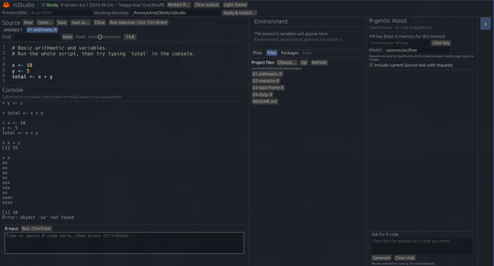

# 🦀 rsStudio

rsStudio is a Linux-first, Rust-native IDE for R. It uses egui for the interface and an installed R interpreter for computation. The project is an early prototype.

## Interface



## Features

- Edit and run R scripts in a persistent R session.
- View R plots in the Plots pane, browse plot history, zoom, and export PNG images.
- Install and load common CRAN and Bioconductor packages.
- Use the OpenRouter-powered R-gentic Assist to inspect selected R environment objects, interpret pasted images, and generate R code; review and run suggestions yourself.
- Choose a light or dark theme.

## Getting started

Install Rust, Cargo, R, and the Linux libraries required by eframe, then run:

```sh
R --version
cargo run
```

Select **Packages** to manage R packages. Import CSV/TSV files from **Environment**, and select objects there to let the assistant inspect them. To use the assistant, open **R-gentic Assist** using the arrow on the right and enter an OpenRouter API key. Its default model is paid; requests can incur charges. Selected data previews and pasted images are sent to the model provider. R code runs with your normal account permissions.

See the [user guide](docs/user-guide.md) for setup details and the [development plan](docs/README.md) for planned features. Data viewing is still in development.

## License

[MIT](LICENSE). R and third-party dependencies have their own licenses. rsStudio is a working name pending trademark clearance and is not affiliated with Posit or RStudio.
